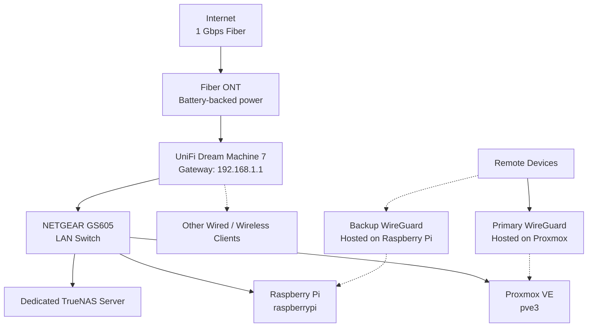

# Network Topology

**Status:** Updated with confirmed router, LAN addressing, DHCP pool, DNS server, wired connections, and primary and backup WireGuard deployments.

## Logical Topology

**Topology notes:**

- Internet connectivity is provided by a 1 Gbps fiber connection through an Optical Network Terminal (ONT).
- The Ubiquiti UniFi Dream Machine 7 serves as the primary router and network gateway.
- The NETGEAR GS605 connects the Proxmox NUC, dedicated TrueNAS server, and Raspberry Pi to the wired LAN.
- The primary WireGuard instance runs on the Proxmox server.
- A secondary WireGuard instance runs on the Raspberry Pi as a backup remote-access option.
- The ONT has battery-backed power. The router uses an EcoFlow battery backup.
- The APC Back-UPS BX1000M provides backup power for the homelab equipment.

The diagram shows the known logical relationships.

## Internet and Network Gateway

| Setting | Configuration |
|---|---|
| Internet connection | Fiber |
| Internet speed | 1 Gbps |
| Fiber termination | Optical Network Terminal (ONT) |
| Primary router | Ubiquiti UniFi Dream Machine 7 |
| LAN gateway | `192.168.1.1` |
| LAN subnet | `192.168.1.0/24` |
| DHCP pool | `192.168.1.6` – `192.168.1.254` |
| DNS server | `192.168.1.205` |
| Main wired switch | NETGEAR GS605 |
| Primary WireGuard host | Proxmox VE server |
| Backup WireGuard host | Raspberry Pi |

## Network Addressing and Migration

The LAN was migrated from `192.168.0.0/24` to `192.168.1.0/24` in September 2026.

The current network configuration is:

- **Subnet:** `192.168.1.0/24`
- **Default gateway:** `192.168.1.1`
- **DHCP address pool:** `192.168.1.6` through `192.168.1.254`
- **DNS server:** `192.168.1.205`

The DHCP pool contains 249 addresses. Addresses outside this pool may be used for infrastructure or statically assigned devices, provided those addresses are configured appropriately and do not conflict with DHCP assignments.

Older configuration files and notes may still contain addresses from the previous `192.168.0.0/24` subnet. Do not assume those addresses remain active.

When troubleshooting network connectivity, verify the device's current IP address, subnet mask, default gateway, and DNS server.

## Known Network Devices

| Device | Role | Network Connection |
|---|---|---|
| UniFi Dream Machine 7 | Primary router and gateway | Connected to fiber ONT |
| NETGEAR GS605 | Wired LAN switch | Connected to the router |
| Proxmox NUC (`pve3`) | Virtualization host and primary WireGuard host | Connected to the GS605 |
| Dedicated TrueNAS server | Network storage | Connected to the GS605 |
| Raspberry Pi (`raspberrypi`) | Utility system and backup WireGuard host | Connected to the GS605 |
| Fiber ONT | Terminates ISP fiber connection | Connected to the router |
| Primary DNS server (`192.168.1.205`) | DNS resolution for the LAN | Pi-Hole on Proxmox |
| VPN DNS server (`192.168.1.206`) | DNS resolution for the VPN Peers | Pi-Hole on Proxmox |
| Secondary DNS server (`192.168.1.201`) | DNS resolution for the LAN | Pi-Hole on Raspberry Pi |

## DHCP and DNS

The UniFi Dream Machine 7 manages the LAN gateway and DHCP address pool. DNS is provided by Pi-hole hosted on the Proxmox infrastructure.

### Network Configuration

| Setting | Configuration |
|---|---|
| Router / gateway | UniFi Dream Machine 7 |
| Gateway address | `192.168.1.1` |
| LAN subnet | `192.168.1.0/24` |
| DHCP pool | `192.168.1.6` – `192.168.1.254` |
| DNS service | Pi-hole |
| Pi-hole address | `192.168.1.205` |
| Pi-hole host | Proxmox VE infrastructure |

### DNS Resolution

LAN clients use Pi-hole at `192.168.1.205` for DNS resolution and filtering.

## Switching and Wireless

The NETGEAR GS605 provides wired connectivity for the Proxmox NUC, TrueNAS server, and Raspberry Pi.

## Remote Access — WireGuard

The homelab has two WireGuard deployments to provide primary and backup remote-access capability.

### Primary WireGuard

- **Host:** Proxmox VE server (`pve3`)
- **Role:** Primary VPN endpoint for remote homelab access

### Backup WireGuard

- **Host:** Raspberry Pi (`raspberrypi`)
- **Role:** Secondary VPN endpoint for backup remote access

The backup WireGuard deployment provides a second VPN endpoint. Automatic failover, independent external reachability, and the exact routes available through each endpoint have not yet been set up.
