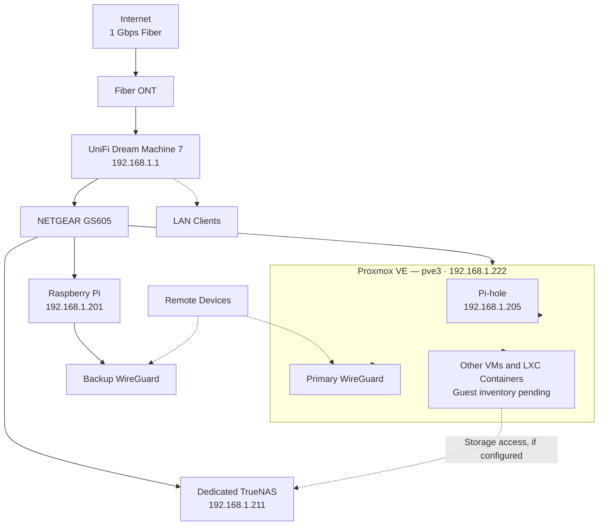

# Architecture Overview

**Status:** Updated to reflect the known physical infrastructure, network design, and service deployments. Individual guest assignments, storage dependencies, and application configurations remain to be verified.

## Design Goals

- Run always-on services on the low-power Proxmox VE host where practical.
- Keep bulk storage and shared media on the dedicated TrueNAS server.
- Provide secure remote access through primary and backup WireGuard deployments.
- Centralize LAN DNS filtering and resolution through Pi-hole.
- Document reverse proxying, monitoring, backups, and recovery procedures.
- Make the environment recoverable after host failures, network changes, and power interruptions.

## Physical Infrastructure

| Component | Hardware / Address | Responsibility | Status |
|---|---|---|---|
| Proxmox VE (`pve3`) | Intel NUC8BEH, 16 GB RAM; `192.168.1.222` | Virtual machines, LXC containers, and hosted services | Active |
| TrueNAS | Ryzen 3 3200G, 16 GB RAM, no discrete GPU; `192.168.1.211` | Dedicated NAS and shared storage | Active |
| Raspberry Pi (`raspberrypi`) | Believed to be Raspberry Pi 3 Model B; `192.168.1.201` | Utility services and backup WireGuard | Active |
| UniFi Dream Machine 7 | `192.168.1.1` | Router, gateway, and network management | Active |
| Pi-hole | `192.168.1.205` | LAN DNS filtering and resolution | Active |
| NETGEAR GS605 | Wired LAN switch | Connects Proxmox, TrueNAS, and Raspberry Pi | Active |
| Fiber ONT | Model to be documented | Terminates the 1 Gbps fiber connection | Active |
| APC Back-UPS BX1000M | 1000 VA / 600 W | Backup power for homelab equipment | Active |
| EcoFlow battery backup | Model to be documented | Backup power for the router | Active |

## Major Software Components

| Component | Responsibility | Current Status |
|---|---|---|
| Proxmox VE | Virtualization platform for VMs and LXC containers | Active |
| TrueNAS | Dedicated network-attached storage | Active |
| Pi-hole | LAN DNS filtering and resolution at `192.168.1.205` | Active |
| WireGuard — primary | Remote VPN access hosted on Proxmox | Active deployment |
| WireGuard — backup | Secondary remote VPN hosted on Raspberry Pi | Active deployment |
| Nginx Proxy Manager | Reverse proxy for selected services | Active deployment |
| Jellyfin | Media streaming | Active deployment |
| Uptime Kuma | Service availability monitoring | Active deployment |

## Logical Architecture

The following diagram represents the known infrastructure and intended service relationships. It is not a complete representation of guest assignments, firewall rules, or application-specific traffic.

This diagram identifies the known hosts and service locations. 

## Network Configuration

The current LAN uses the `192.168.1.0/24` subnet.

| Setting | Value |
|---|---|
| LAN subnet | `192.168.1.0/24` |
| Default gateway | `192.168.1.1` |
| DHCP pool | `192.168.1.6` – `192.168.1.254` |
| DNS server | `192.168.1.205` |
| Primary VPN host | Proxmox VE |
| Backup VPN host | Raspberry Pi |

The LAN was migrated from `192.168.0.0/24` to `192.168.1.0/24` in September 2026. Historical addresses should not be assumed to remain active.

## Important Dependencies

### DNS

LAN clients rely on Pi-hole at `192.168.1.205` for DNS filtering and resolution.

### Storage

TrueNAS provides the dedicated NAS platform.

### Remote Access

The primary WireGuard deployment runs on Proxmox, while a backup deployment runs on the Raspberry Pi. Both provide separate VPN endpoints, but automatic failover and route equivalence have not yet been setup.

### Power and Recovery

The homelab and Fiber ONT use an APC Back-UPS BX1000M for equipment backup power, with an EcoFlow battery backup for the UniFi Dream Machine 7. 

## Recovery Priorities

1. Restore router, LAN connectivity, and DNS resolution.
2. Restore Proxmox VE and confirm VM/LXC startup.
3. Confirm TrueNAS availability and storage-pool health.
4. Verify shared-storage mounts and dependent applications.
5. Restore primary or backup WireGuard remote access.
6. Verify reverse-proxy routes, application access, and monitoring.
